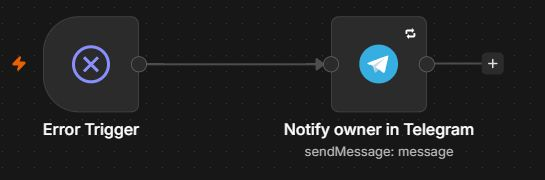

# Demo walkthrough

This page lets a reviewer inspect the workflow without an n8n account or a live Telegram demo. Quoted responses below come from observed tests. The card layout is a text reconstruction; it is not a screenshot of a second customer/staff account setup.

## 1. A customer raises an authenticity concern

> I think this watch might be counterfeit.

The updated classifier returned:

```json
{
  "category": "authenticity",
  "priority": "high",
  "summary": "Customer suspects the watch might be counterfeit.",
  "draft": "Thank you for reaching out to SOLOMIA WATCH CO. A human specialist will review your request regarding the authenticity of your watch."
}
```

This was an isolated regression check of the classifier, with no customer message sent by that test. Earlier Telegram tests exercised creation of the staff review card.

## 2. Staff receive a review card

```text
New ticket #<ticket_id>
Category: authenticity
Priority: high

Customer message:
I think this watch might be counterfeit.

Summary:
Customer suspects the watch might be counterfeit.

Draft for review:
Thank you for reaching out to SOLOMIA WATCH CO. A human specialist
will review your request regarding the authenticity of your watch.

[ ✅ Send to customer ]  [ 👤 Take over ]
```

The AI draft is not sent to the customer automatically. The ticket is stored as `pending`, and the callback must come from the configured staff user.

## 3. The employee chooses an action

| Choice | Customer-facing result | Stored result |
|---|---|---|
| Send to customer | The saved draft is sent to `client_chat_id`. | `status = sent`; `updated_at` is refreshed. |
| Take over | A fixed acknowledgement says a specialist has taken over. | `status = human`; `updated_at` is refreshed. |

Both paths check `pending`. The observed sequential repeat clicks did not send a second reply. This does not prove safety against two concurrent clicks.

For the greeting “Hello again.”, the saved execution showed the greeting draft retained, the original ticket fields intact, and status changed to `sent` after delivery. Personal identifiers are omitted from this public case study.

## 4. Failure behavior

**Handled AI failure:** a provider/parser error follows the classifier's error output. The request is saved with summary “Automatic classification failed; human review required.” and a neutral fallback draft for staff review.

**An execution stops:** the assigned Error Workflow constructs a notification with the workflow name, failed node, and execution link. It avoids copying the customer's message, a raw error stack, or credentials into the alert.

The notifier was tested using n8n's synthetic Error Trigger sample. Telegram accepted the notification with `ok: true`. A fresh fatal production failure was not deliberately injected into the customer workflow.



## What to review in the source

1. `Basic LLM Chain1`: prompt boundaries and the `continueErrorOutput` setting.
2. `Insert row`: fallback expressions and initial `pending` status.
3. `If4`: callback sender allowlist.
4. `If2` / `If3`: pending-state checks before customer messages.
5. The two update nodes: state transitions and ISO timestamps.
6. `error-workflow.json`: sanitized notification content and delivery retries.
